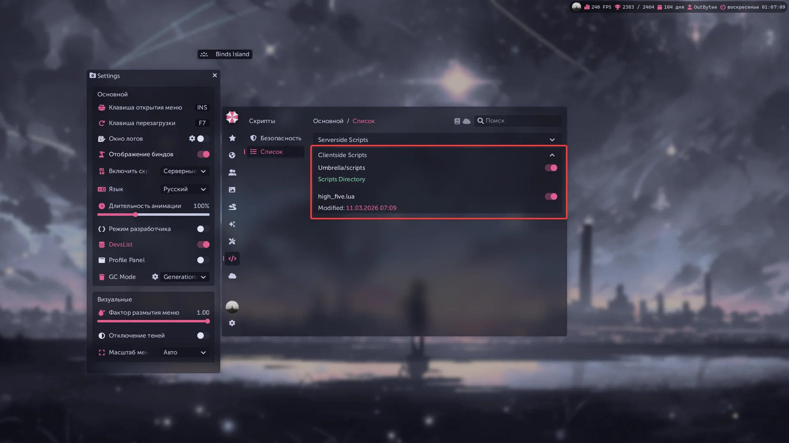

# UmbrellaScripts

**A community-maintained collection of Lua scripts, utilities, and themes for the Umbrella Dota 2 client.**

[](#)
[](#)
[](#)

UmbrellaScripts provides a browsable collection of community-created Lua scripts and Umbrella interface themes. Each entry is documented to help users discover its purpose, menu options, source location, and installation requirements.

## 〢 💭 What is UmbrellaScripts?

UmbrellaScripts is an independent, unofficial collection of resources for the Umbrella Dota 2 client. The repository aims to make scripts and themes easier to discover, browse, understand, and install.

This is a community collection, not an official Umbrella project. The repository primarily contains work created by independent developers and community members; it does not claim that every resource is maintained or authored by the repository maintainer.

## 〢 ✨ Features

- Organized script categories for heroes, items, miscellaneous utilities, visual tools, and general utilities
- Individual documentation for every Lua script
- Preserved Umbrella theme codes with preview images where available
- Beginner-friendly installation steps
- Direct navigation to source files and documentation
- Prominent credits and redistribution guidance

## 〢 📂 Repository Structure

```text
UmbrellaScripts/
├── Heroes/          Hero-specific scripts
├── Items/           Item-related scripts
├── Miscellaneous/   Session tracking and other standalone tools
├── Utility/         Umbrella utilities
├── Visual/          Cosmetic and visual tools
├── Themes/          Umbrella theme codes and previews
├── assets/          Main README installation images
└── README.md
```

- [Heroes](./Heroes/)
- [Items](./Items/)
- [Miscellaneous](./Miscellaneous/)
- [Utility](./Utility/)
- [Visual](./Visual/)
- [Themes](./Themes/)

## 〢 📜 Script Collection

### Heroes

| Script | Description | Languages | Documentation |
|---|---|---|---|
| [Ember Spirit Sticky Combo](./Heroes/Ember Spirit/EMBERSCP.lua) | A cursor-directed Ember Spirit combo trainer with configurable combo, escape, targeting, ability, item, and display behavior. Intended to operate only in the documented hero-demo environment unless private-lobby use is explicitly enabled. | English and Russian menu text | [README](./Heroes/Ember Spirit/README.md) |
| [Huskar Life Break Combo](./Heroes/Huskar/huskar_life_break.lua) | Automates and interrupts Huskar's Life Break leap with Blink or Hurricane Pike, with configurable direction, delay, and leap-breaking behavior. | English, Russian, Chinese | [README](./Heroes/Huskar/README.md) |
| [Invoker Auto Sun Strike](./Heroes/Invoker/Auto_Sunstrike_On_TP.lua) | Detects enemy teleport activity and invokes Sun Strike to aim at the predicted arrival position. | English | [README](./Heroes/Invoker/README.md) |
| [Nature's Prophet Treant Block](./Heroes/Natures Propeth/furion_treant_block.lua) | Provides configurable Treant Protector block-assist controls, visual icons, and key/hold behavior for Nature's Prophet. | English, Russian, Chinese | [README](./Heroes/Natures Propeth/README.md) |
| [Phantom Lancer Illusion Controller](./Heroes/Phantom Lancer/pl_v2.lua) | Controls Phantom Lancer illusions through rush, bait, follow, chase, bodyblock, retreat, split-attack, and status functions. | English | [README](./Heroes/Phantom Lancer/README.md) |
| [Phoenix Supernova Survival Panel](./Heroes/Phoenix/Phoenix_Supernova.lua) | Displays a configurable panel estimating whether Phoenix's egg will survive nearby enemy attacks while Supernova is active. | English | [README](./Heroes/Phoenix/README.md) |
| [Timbersaw Combo](./Heroes/Timbersaw/timbersaw_combo.lua) | Holds a configured combo key to use Timber Chain, Blink, selectable items, and Chakram against a cursor-selected enemy. | English | [README](./Heroes/Timbersaw/README.md) |
| [Tusk Walrus Kick Combo](./Heroes/Tusk/tusk.lua) | Configures a Tusk Walrus Kick combo using selected allies, a Blink Dagger, Linken breaker items, and Snowball. | Russian menu text | [README](./Heroes/Tusk/README.md) |

### Items

| Script | Description | Languages | Documentation |
|---|---|---|---|
| [Smart Armlet Abuse](./Items/Armlet/smart_armlet_abuse.lua) | Dynamically adjusts Umbrella's built-in Armlet Abuse threshold based on estimated nearby damage and survival probability. It does not toggle Armlet directly. | English | [README](./Items/Armlet/README.md) |

### Miscellaneous

| Script | Description | Languages | Documentation |
|---|---|---|---|
| [MMR Tracker Ultimate](./Miscellaneous/MMRTracker_Ultimate.lua) | Tracks MMR session results, displays an on-screen panel and calculator, and includes configurable tilt alerts. | Russian and English menu text | [README](./Miscellaneous/README.md) |

### Utility

| Script | Description | Languages | Documentation |
|---|---|---|---|
| [Server Region](./Utility/server_region.lua) | Reads the lobby server-region information, requests it from the game coordinator when needed, and displays a configurable region indicator. | English | [README](./Utility/README.md) |

### Visual

| Script | Description | Languages | Documentation |
|---|---|---|---|
| [Unusual Changer](./Visual/unusual.lua) | Applies selected unusual-style ambient effects to supported hero cosmetic items, with test and preview controls. | Russian | [README](./Visual/README.md) |

## 〢 🎨 Themes Collection

| Theme | Preview | Theme Code | Documentation |
|---|---|---|---|
| [Purple Transparent](./Themes/Purple Transparent/) | Preview unavailable | `59f149fe-d8804167` | [README](./Themes/Purple Transparent/README.md) |
| [Blue not Transparent](./Themes/Blue not Transparent/) | [Preview](./Themes/Blue not Transparent/img/image.webp) | `990f80ef-ae824a31` | [README](./Themes/Blue not Transparent/README.md) |
| [Forest green](./Themes/Forest green/) | [Preview](./Themes/Forest green/img/image.webp) | `b3d7164d-4a3f4d47` | [README](./Themes/Forest green/README.md) |
| [Gothic Veil](./Themes/Gothic Veil/) | [Preview](./Themes/Gothic Veil/img/image.webp) | `bbfc2134-562d40ab` | [README](./Themes/Gothic Veil/README.md) |
| [Mint Leaf](./Themes/Mint Leaf/) | [Preview](./Themes/Mint Leaf/img/image.webp) | `0124e755-20d047f4` | [README](./Themes/Mint Leaf/README.md) |
| [Neverlose.cc theme](./Themes/Neverlose.cc theme/) | [Preview](./Themes/Neverlose.cc theme/img/image.webp) | `f993e965-a70d472e` | [README](./Themes/Neverlose.cc theme/README.md) |
| [Pink Transparent](./Themes/Pink Transparent/) | [Preview](./Themes/Pink Transparent/img/image.webp) | `352cdc1a-be5346a0` | [README](./Themes/Pink Transparent/README.md) |

Theme installation instructions have not yet been verified. Apply codes only through a method documented or exposed by the Umbrella client.

## 〢 📥 Installation Guide

### 〢 📁 Step 1 — Move the Script

Open your Umbrella client directory, locate the `scripts` folder, and copy the downloaded Lua script into it.


### 〢 ⚙️ Step 2 — Enable Custom Scripts

Launch Dota 2 and open the Umbrella menu by pressing the Insert key.

Navigate to the client settings and make sure the Enable Scripts option is enabled.


### 〢 🔄 Step 3 — Reload Scripts

Use the script reload or restart option in the Umbrella client to refresh the available script list.

### 〢 ✅ Step 4 — Enable the Script

Find the installed script in the Scripts category and enable it if it is not already active.

Some scripts may appear in a hero, item, utility, or miscellaneous category instead of the general Scripts category.

## 〢 📖 Documentation

Each script README includes the available overview, source-derived features, menu settings, usage notes, and credits. Theme READMEs preserve the exact theme code and include previews where the repository provides one.

Use the [Script Collection](#-script-collection) and [Themes Collection](#-themes-collection) sections as the main navigation hubs.

## 〢 👥 Credits & Attribution

Most scripts and themes included in this repository were created by independent developers and members of the Umbrella community.

I do not claim ownership or original authorship of third-party content. Full credit belongs to the respective original creators. Whenever possible, author names, original repositories, and source links are included in the corresponding documentation.

If you are an original creator and would like your work to be properly credited, updated, or removed, please open a GitHub issue.

## 〢 📋 Attribution Policy

### Original Ownership

Scripts and themes remain the intellectual property of their respective creators.

### Creator Recognition

Original authors receive appropriate credit whenever their identities are known.

### Redistribution Permissions

Public availability does not automatically confirm redistribution permission. Attribution does not replace permission or an applicable license. Redistribution permissions are unverified for the scripts and themes in this collection unless documented source evidence states otherwise.

### Correction Requests

Creators may request corrections to author information or source links.

### Removal Requests

Creators may open an issue to request removal of their work. Legitimate ownership and licensing concerns will be reviewed.

### Licensing

No repository-wide license is intended to claim ownership of third-party scripts or themes. Existing third-party licensing information is preserved where present.

## 〢 ⚠️ Disclaimer

UmbrellaScripts is an independent, unofficial community repository. It is not affiliated with, endorsed by, or maintained by Umbrella or Valve.

Third-party scripts and themes belong to their respective creators. Compatibility may vary between Umbrella client versions and Dota 2 updates. Not every script or theme has been independently tested in-game, and users should review third-party code before running it.

Users are responsible for complying with applicable platform rules and terms. The repository does not guarantee that every script or theme will work correctly.
